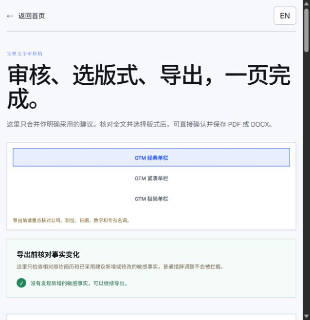
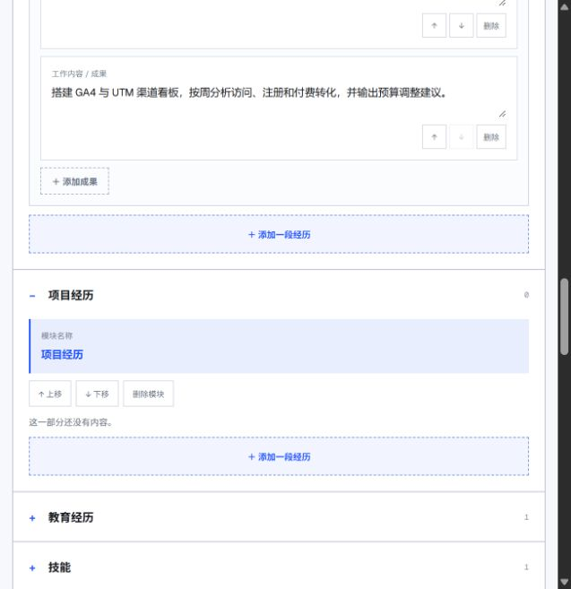
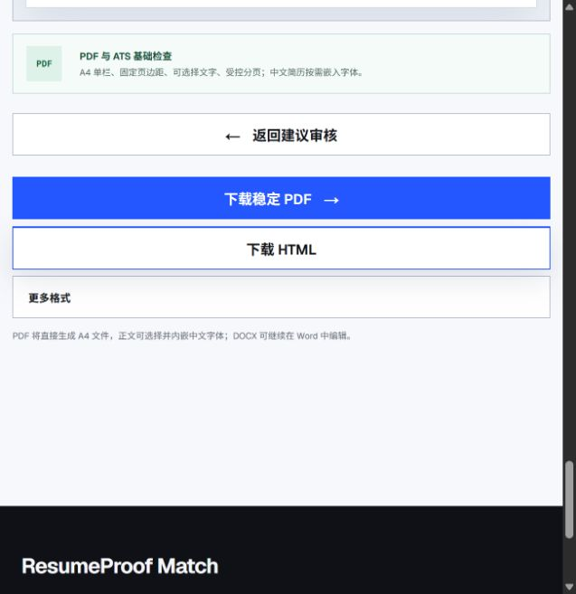
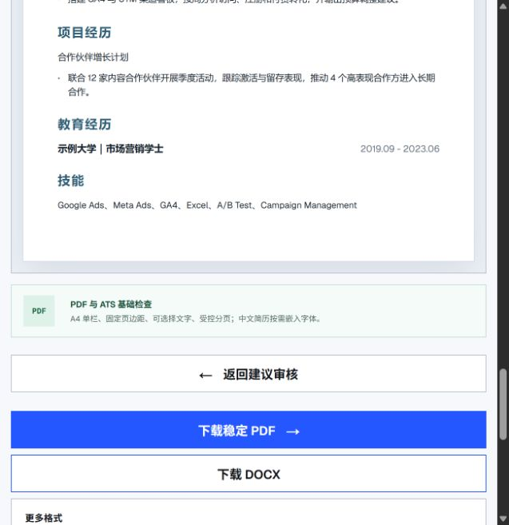

# ResumeProof 全流程审查 — 2026-09-09

## 范围和依据

目标：帮助求职者理解岗位差距，并以更少操作得到真实、可编辑、可投递的简历。

本轮使用内置浏览器检查线上首页、材料、示例报告、真实 AI 分析、建议审核、结构化编辑及导出入口。截图视口约 637 × 657，是窄窗口，不等同于完整手机或桌面设备矩阵。另检查当前本地代码并运行隔离诊断，没有修改产品源码或发布。

真实 AI 测试使用公开示例，未勾选样本保存。开始后约 17 秒的检查点已看到完整结果；这不是精确响应时间或 P95。测试产生少量正常分析与产品事件，可能进入统计。未上传用户真实简历。

后台进入现有账户选择后，OpenAI 登录页返回 400 Invalid content type。本轮后台分析限于代码，未查看账户报表或更改后台设置。PDF/DOCX 的实际成品、多页扫描 OCR、真实招聘网站链接、200% 缩放、屏幕阅读器及全设备矩阵未验收。

## 核心判断

基础功能和明确采用建议的流程已存在，但现在的主要矛盾是：视觉优先展示说明文字，底层仍把结构化简历当作一段文本来回转换。前者让操作靠后，后者导致内容不可编辑、日期归属错误和审核遗漏。下一轮应合并改善工作区视觉和数据结构。

## 逐步检查

| 步骤 | 当前状态 | 建议方向 |
| --- | --- | --- |
| 1 首页 | 品牌蓝与黑字有辨识度；口号较抽象，示例进入首屏较晚 | 标题直接说明匹配 JD 与修改简历；首屏放真实原文/修改/理由示例 |
| 2 准备材料 | 上传、粘贴、本机保存均有入口；标题占地大，标签与操作字小 | 压缩页头，输入区上移；字号与控件统一；已读取内容用摘要卡展开 |
| 3 分析报告 | 本轮真实调用成功；出现优势和差距相互矛盾 | 所有概述从统一证据生成；结论、关键差距与行动放一起 |
| 4 建议审核 | 支持采用、修改、跳过；默认示例仅替换近义词 | 显示真实改善点；无实质改善可直接保留原文；未处理建议默认不合并 |
| 5 简历编辑 | 项目内容在预览中存在，但编辑区显示 0 项 | 无法结构化的内容必须有可编辑回退；公司/职位/日期独立存储 |
| 6 预览与导出 | 三种版式与 PDF/DOCX 入口存在；窄屏预览在全部编辑区之后 | 宽屏编辑+预览；窄屏编辑/预览切换；模板与导出共享状态 |
| 7 后台与埋点 | 本轮登录受阻；代码存在事件漏接与漏斗口径问题 | 修复统计合同、按匹配去重；后台后续补做真实登录验收 |

## 应先修复的逻辑问题

### P0：内容完整性和事实审核

1. **项目经历不可编辑，已在线复现。** 示例“合作伙伴增长计划”在预览中存在；编辑区却显示“项目经历 0 / 这一部分还没有内容”。`entryCards()` 只接受 entry 类型，前置 body/bullet 不会生成卡片。依据：`app/components/resume-structured-editor.tsx:39`、`app/match/new/page.tsx:142`。诊断结果 displayedCards=0。应保留未识别段落，提供普通文本卡片或人工指定标题。
2. **日期输入会进入职位字段，隔离复现。** 填写日期首字符 `2` 后，下一次解析得到 role=`Manager 2`、date=`空`。来源是每次输入都拼接成文字再用完整日期正则反解析。依据：`resume-structured-editor.tsx:54,60,126`。需把组织、职位、起止日期和成果直接存储为字段，导出时再序列化。
3. **新增事实确认机制不闭合，已在线复现。** 真实建议把“协调上线”改为“确保素材按计划上线并达成季度目标”。界面先警告新增事实，但点击“修改后采用”后不更改任何文字也能“确认采用修改版”；最终显示“没有发现新增的敏感事实”。`buildTextReview()` 以合并后的文本作为审核基线（`page.tsx:763`），而不是携带已知新增事实及其确认记录。应记录每一事实的来源/用户确认，基线更新不能抹掉未核实事实。
4. **数字在不同成果之间调换会漏报，隔离复现。** “注册提升28%，入金提升12%”改成“注册提升12%，入金提升28%”，返回零变更。当前检测比较全篇数字集合，未核对数字所属事项（`fact-audit.ts:15,58–63`）。应按同一经历/同一成果比较；中文新增职责也需要检查。不能把正则未命中解释成事实已被验证。

### P1：分析质量与结果可靠性

5. **优势、差距与建议没有一致性校验，线上出现真实矛盾。** 同一报告一处称有“优化 CPA/ROAS 的实战经验，如注册成本下降28%”，另一处称“缺乏对 CPA/ROAS 优化的量化成果展示”。注册成本不等于 ROAS。建议结果按具体指标拆分，所有概述与建议引用统一 requirementId/evidenceId。当前两路 AI 并行能减少等待，但改写未消费匹配结果；保留并行也需合并时校验关联。
6. **短事实被丢弃，隔离复现。** `resumeSources()` 跳过少于18字符的段落；“学历：本科。”“语言：英语流利。”会被丢弃（`analyze/route.ts:160`）。这类短句往往恰好决定硬门槛。应保留结构化事实，不用统一字符阈值判断重要性。
7. **合法的低匹配报告仍可能报失败。** `coreIsComplete()` 要求至少一个引用、至少一个优势和差距（`:259`）；完全不相关简历的全gap报告被拒绝。应区分“没有匹配”与“生成失败”，允许无优势、无改写，也允许全面满足时无差距。
8. **评分的分母和结论要解释清楚。** 当前只选5–8项要求，最多保留8项证据；引用存在仅证明原句存在，不证明语义匹配正确。`verifiedEvidence` 是有引用项占全部证据项的比例，并非逐条审核通过率（`:219`）。任一must缺口会转为skip，即使只是简历没写。建议明确“已覆盖/未证实/明确不满足”，漏写证据优先引导补充；合并近义要求，展示评分分母。
9. **前导空白可让已采用建议静默失效，隔离复现。** 服务端 trim 简历后生成字符位置（`:360`），前端用未trim原文校验原句（`page.tsx:742起`）。粘贴内容以空格或换行开头时位置偏移，修改被过滤但采用计数可能仍增加。应统一输入规范化和稳定块ID，合并失败应说明原因。
10. **慢请求的反馈仍只有计时，失败与无建议混淆。** 报告/建议使用 allSettled 等待；若核心先成功，用户仍等慢建议。建议请求失败被折算为空数组，无法区分“无需修改”和“未完成分析”。建议先给完整核心结果，再更新建议模块的真实状态；共享截止时间，防止过期响应覆盖新材料。验收需覆盖快速换文件/改JD和超时重试。

### P1：导出一致性、本机保存与数据

11. **DOCX 没有使用选中的模板。** `resumeDocxBlob(blocks, language)` 不接收template（`page.tsx:249,874`），与PDF和HTML不同；DOCX页面未显式声明A4。窄屏CSS又会改字号、边距，网页估算页数不等于PDF实际页数。应统一模板参数，并用真实PDF分页结果作为下载前预览。
12. **本机保存反馈和数据边界仍有欠缺。** 保存异常被静默吞掉；清除失败也会显示已清除；首次保存前只说“本机”，完整的持续保存提示在保存后才出现。应显示明确成功/失败和日期，在保存前说明保存的是识别后文字。首页/材料页“仅当前标签页”的总述也需与可选持久保存一致。
13. **新功能埋点没有接入后台白名单，隔离验证。** base_resume_saved/loaded/cleared 均不在 `product-events.ts` 的允许事件中，接口会返回 INVALID_EVENT；客户端会继续发送到GA4，但内部后台不会记录。需统一事件定义与属性名，避免两端不一致。
14. **漏斗是事件次数，而不是同批用户转化。** `admin-runtime.ts:262` 用page_view、analysis_started、export等计数相除；多次分析、重试、导出和示例会混入。渠道表已按旅程去重，但主漏斗不是相同口径。建议用matchId跟踪一次匹配，按先后顺序去重；示例与真实用户分开。后台统计读取默认最多10000条，需在数据库聚合并标注完整性。
15. **可选样本的摘要没脱敏。** 正文调用redactMaterial，但summary直接存储（`content-samples.ts`）。模型若在摘要复述姓名或公司等，样本可能仍带信息。服务端限流是进程内Map，不能视为跨实例全站限额；请求大小主要依赖Content-Length，应在真正读取正文时约束。属于代码发现，未实施攻击或压力测试。

## 前端视觉的具体调整

保留品牌蓝、黑色文字和浅色背景。首页可以保留较强展示感；操作页面用更紧凑的工作台：

- 字级：工作区页标题建议28–32px；模块标题18–20px；正文16px；常用标签14px；说明不低于12px。现有标签与按钮大量使用9–11px，窄窗口尤其难读。
- 留白：减少页头和模块前的空白，增加同一成果内部的行距；按8/16/24/32px组织间距。大留白留给不同任务之间，小留白用于字段内部。
- 表面层级：一段经历只保留一层主要卡片边框；“模块名称”改为标题旁编辑；移动、复制、删除收进经历级菜单，减少每行三枚按钮。
- 材料页：首屏直接看到上传区域；已读取后用文件状态+字数+展开文字。不要重复两遍服务商说明，保留一次清楚说明及隐私链接。
- 结果页：首屏显示岗位、结论、证据不足的具体事项和下一步；优势、差距、证据合并，证据按需展开。问“有没有帮助”移到用户读完或采取动作之后。
- 审核页：顶栏放模板、保存状态与导出；桌面模块导航+编辑+预览，窄屏编辑/预览切换。零异常的事实提示压缩为一行，有待核对事实再展开。
- 模板名称：面向不同求职方向使用“经典 / 紧凑 / 极简”，GTM个人模板来源不必成为所有用户的产品术语。
- 示例：展示删掉无关信息、重排重点或让已有成果更清楚的真实变化。当前“通过→基于、使→推动”不足以证明价值。
- 可访问性：材料文本框需要明确名称，不能让屏幕阅读器只读“425字符”；检查焦点可见性、radio键盘操作和按钮触摸面积。此项是代码/AX发现，不是完整无障碍认证。

## 实施和验收顺序

第一批：结构化字段、漏显内容、事实确认、字符位置一致性。验收：任意现有内容都可编辑；输入半个日期不移动字段；未核实新增成果不能被基线重置掩盖；数字互换被指出。

第二批：工作区视觉一起调整。验收：窄屏首屏能开始输入；编辑/预览可直接切换；字号可读；常用操作不需要滚完整页。

第三批：统一分析证据、合法空结果、渐进反馈、模板共用参数及事件合同。验收：全gap和全满足均能返回合理报告；修改原因不与证据冲突；三个模板在PDF/DOCX遵循明确一致规则；示例、重试和真实完成可分辨。

## 本轮截图

### 1 首页

### 2 材料

### 3 示例报告

### 4 审核页首屏

### 5 项目无法编辑

### 6 导出菜单

### 7 真实改写含新增成果

### 8 实际审核稿预览与可用导出入口

隔离诊断：本目录 diagnostics.cjs，读取当前函数进行复现，不调用外部AI、不访问数据库。
