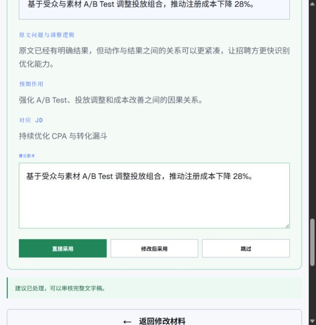
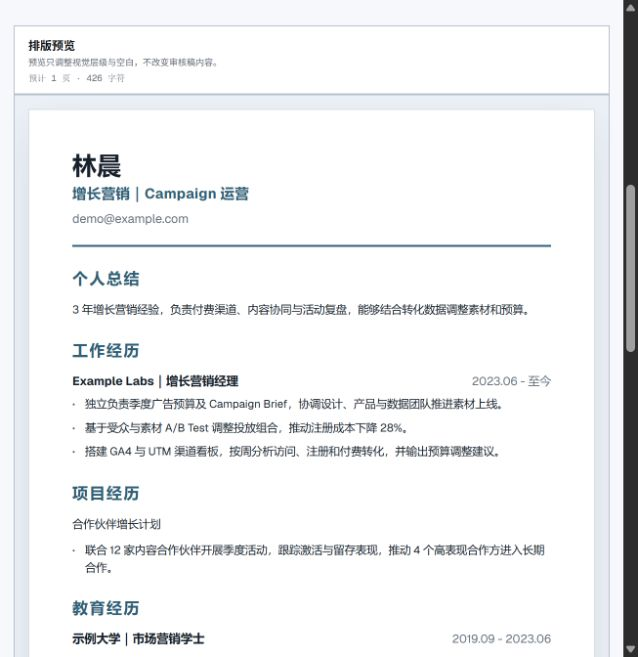
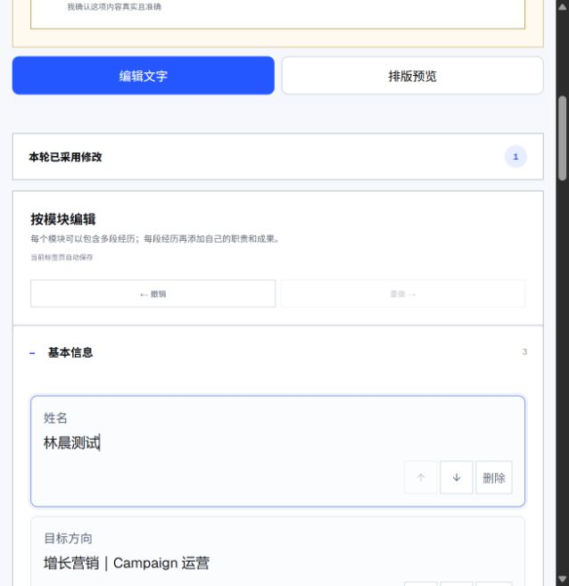
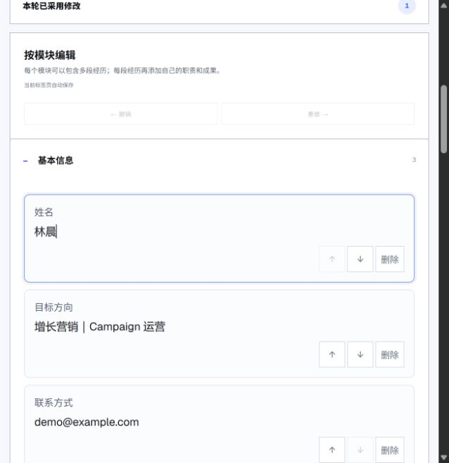

# ResumeProof 当前线上体验审查

日期：2026-09-11。目标：让首次使用者快速理解价值、完成材料输入、获得可行动的分析，并保留自己的修改直到导出。

依据：本次内置浏览器的线上页面、公开示例交互和当前代码。截图为约 653 × 672 的窄窗口，不代表完整桌面或手机测试。没有修改产品代码或发布；上轮分析接口的未提交修改仍保留。本轮未调用真实 AI、上传个人材料或下载成品，故不能评价真实耗时、OCR 成功率或实际文件分页。

## 结论与优先级

功能入口已较完整，蓝色主操作、单栏简历预览及编辑/预览切换可保留。当前最重要的问题依次是：手工修改能否保留、结果如何引导下一步、编辑控件是否过多、示例能否证明价值。动效应围绕状态反馈设计。

| 步骤 | 健康度 | 当前证据与建议 |
| --- | --- | --- |
| 1 首页 | 可理解，价值展示不足 | 标题清楚；ALIGNMENT LAB 展示词语对应，尚未展示修改前后及理由。换成一条有实质改善且保留原始事实的交互示例。 |
| 2 添加材料 | 可用，有冗余 | 简历和 JD 在同页；窄屏先看到状态条、示例入口和简历卡，JD 在下方。材料状态贴近各自字段；示例改轻量入口；数据处理说明集中展示。 |
| 3 分析报告 | 内容丰富，行动靠后 | 首屏先展示“证据先于分数”说明，英语待确认在摘要、差距、硬条件、补证多处重复。改为岗位名称、结论、最高优先级事项和“去修改”，证据与算法解释展开查看。 |
| 4 建议采用 | 可操作，示例改善弱 | 示例只改近义词，理由却占较大空间；采用后同一建议又出现一份文本框。高亮差异，原因压缩到一条，采用后显示完成状态，继续编辑时再展开输入框。 |
| 5 编辑与事实核对 | 存在高优先级问题 | 修改示例姓名后返回建议再进入审核，姓名恢复原文。无事实变化的近义词替换也触发数字核对。先保留手工草稿，再细化核对差异。 |
| 6 预览与导出 | 预览清晰，完成感不足 | 三版式、预览和下载入口存在；模板主要靠名称区分，窄屏下载在正文末尾。加小型版式预览和轻量导出栏；最终文件仍需单独验收。 |

## 先修的使用逻辑

1. **P0 保留手工编辑。** 本次将示例姓名改为“林晨测试”，点击“返回建议审核”，再点“进入完整文字审核稿”，字段回到“林晨”。代码 buildTextReview 每次从 resumeText 重新合并。返回已有审核稿时应直接恢复当前草稿；建议变化时只合并受影响的段落，冲突处让用户选择保留哪个版本。验收：改姓名、补经历、排序后往返，内容和顺序都不丢失。
2. **P1 核对具体变化。** 示例“通过…使注册成本下降 28%”变为“基于…推动注册成本下降 28%”，数字及所属结果未变，仍要求确认。当前整句比较偏保守。建议优先识别数字和所属指标、责任范围、公司职位日期的变化；只改措辞时展示差异即可。无法判定时明确待核对的内容，不把整段一律称作数字变化。
3. **P1 结果直接连接动作。** 将硬条件待确认、已有经验没写清、确实缺少经验区分；每条对应“补充真实信息”“采用建议”“保留差距”。不要让用户在多个重复列表之间自己拼结论。

## UI 和页面展示

- 保留品牌蓝与浅背景。主按钮用蓝色，成功状态用小范围绿色，待核对用局部提示；避免整张卡和大段正文都承担强调。
- 一段经历使用一层卡片。公司、职位、日期放同组；职责是可增删的列表。复制、移动、删除放进经历级更多菜单，并保留键盘可用的操作。姓名、联系方式不必逐行提供排序按钮。
- 模块名称直接在标题处改名，避免标题下重复一块“模块名称”。常用标签约 14px、正文约 16px，主要按钮至少约 44px 高；辅助说明要与背景有足够对比度。
- 宽屏建议模块导航、编辑、预览组合；窄屏保留现有编辑/预览切换，并给导出提供不遮挡内容的固定入口。此项宽屏布局是建议，本次未验收宽屏。
- 首页用一条“原文—针对哪个岗位要求—建议版本—修改理由”的真实示例证明价值；既有示例近义词替换不足以承担这一任务。
- 三种模板增加缩略图和适用说明；切换保留阅读位置。将“预计页数”和实际 PDF 分页清楚区分。

## 动效与反馈

前台当前以 CSS 过渡和页面切换为主，代码中的 GSAP 集中在后台。没有必要为了使用 GSAP 扩大动画范围。

| 触发 | 建议反馈 | 目的 |
| --- | --- | --- |
| 文件读取完成 | 文件卡短暂高亮，显示已读取/需要核对 | 让用户知道文件处理结果 |
| 分析等待 | 显示后端真实阶段；阶段不可知时显示“正在分析，可继续等待或重试”，不伪造百分比 | 降低对卡住的疑虑 |
| 采用建议 | 约 150–200ms 状态变化，明确“已采用”，可撤销 | 确认操作生效 |
| 增加或排序经历 | 约 180–240ms 位置过渡并将焦点移到新增字段 | 帮助用户跟踪内容位置 |
| 展开证据 | 约 160–220ms 展开；减少动态效果时直接显示 | 保持上下文 |
| 导出 | 生成中、已开始下载、失败重试三种清晰状态 | 区分生成完成与文件已保存 |

首页可选一次轻量入场。持续循环光效、数字滚动、强制滚动与整页飞入不能直接改善这些任务，优先级低。

## 验收与限制

本次在线复现草稿往返覆盖和近义词改写触发事实核对。编辑/预览切换可用，当前窄视口没有观察到横向溢出。AX 中编辑/预览被呈现为可按下的切换控件；建议统一 tab 语义、选中状态及焦点迁移。重复“删除”按钮需要带所属经历的可访问名称。

没有完成屏幕阅读器、200% 缩放、手机键盘、减少动态效果的实机测试，不作无障碍合规结论。截图不能证明动画时序或导出文件正确。AI 速度优化和 PDF/DOCX 逐页检查仍是未完成事项；缩短超时或输出上限本身不是提速证据。

实施顺序建议：先修手工草稿保留与事实误报；再合并结果页信息、简化编辑控件；最后补状态动效、模板预览和导出验收。完成率、进入编辑耗时、导出成功率可用于验收效果，不以新增动画数量判断改善。

## 本次截图

### 1 首页

### 2 添加材料

### 3 结果首屏

### 4 采用后的建议卡

### 5 近义词修改触发事实核对

### 6 排版预览

### 7 手工修改后

### 8 返回建议再进入，修改被覆盖

