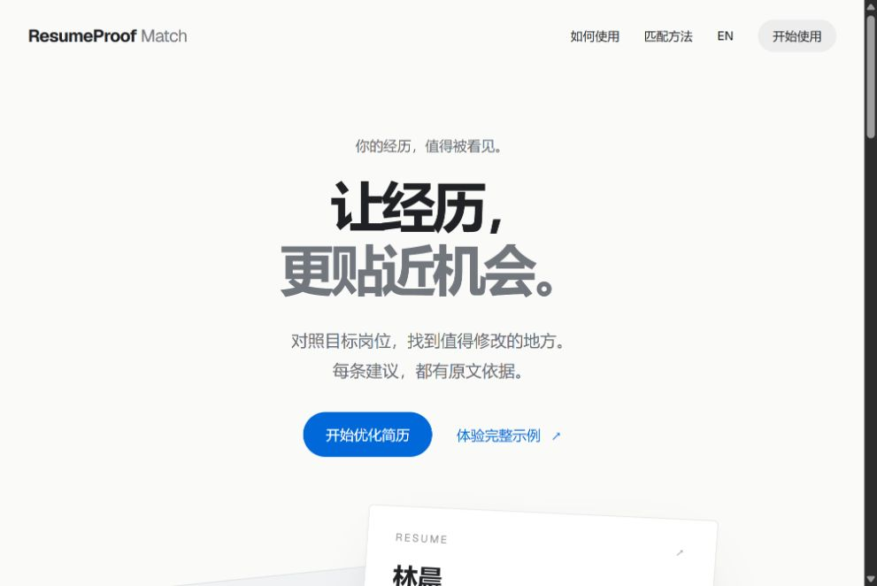
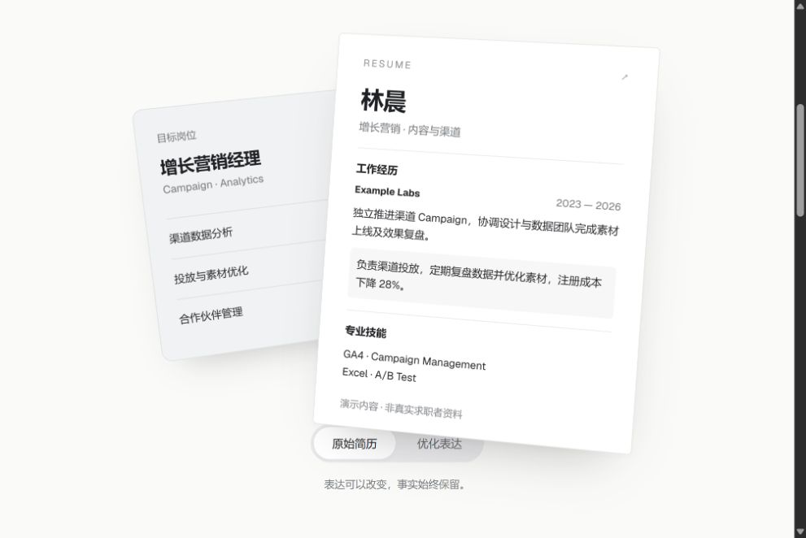
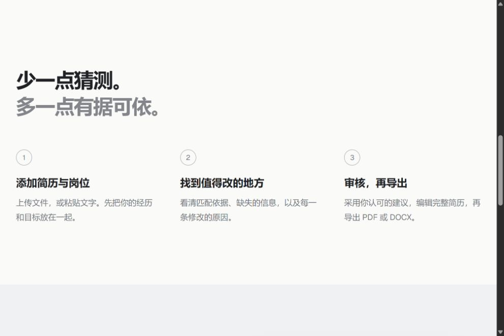
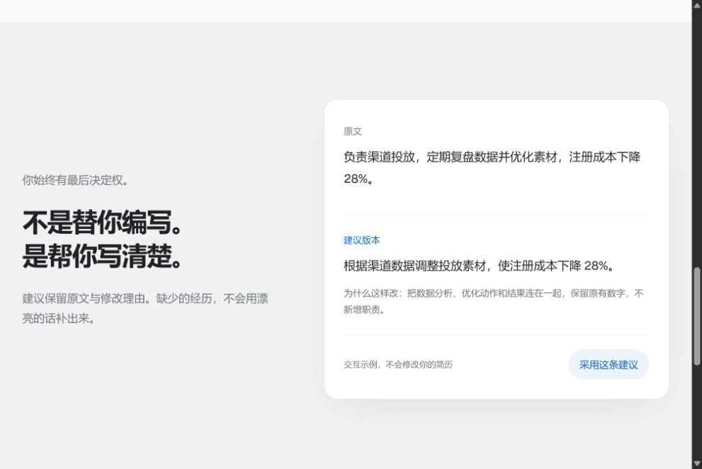

# 首页原型审核

范围：2026-09-14 本地 /concept，当前桌面视口。只审核，不修改产品代码。

## 1. 首屏：方向清楚，排版需调整

主操作明显，配色克制。中文标题使用 -0.065em 字距，视觉过紧；英文与中文应使用不同排版参数。首屏大部分空间用于文案，产品展示仅露出顶部。建议降低首屏顶部空白，中文恢复接近正常字距，减少开场小字与主标题的信息重复。

## 2. 立体文档：存在遮挡

前方简历遮挡岗位状态；文档底部覆盖版本切换按钮。源码固定 440px 高的展示容器，绝对定位文档内容可超出容器。应先以内容确定高度，装饰倾斜不得侵入按钮区域。岗位缺口需保持可见，手机不能仅隐藏岗位信息。

## 3. 三步说明：可读，但空间利用偏低

三列步骤清楚；标题到内容以及区块之间留白较大。文案以“有据可依”等理念为主，和前后区块重复。建议压缩为紧凑流程摘要，将更多空间用于具体结果展示。保持组内间距小于组间间距，正文 16–18px、行高约 1.6–1.75 作为调试起点。

## 4. 修改对照：可理解，但说服力不足

原文与建议、原因、操作齐全。但示例主要是缩短一句话，未展示与目标岗位的对应关系。应展示同一条 JD、已有原文证据、差异标记与修改原因，明确哪些事实保持不变。将岗位不确定项标记为“未找到证据”，避免“待补充”暗示必须补出经历。保留演示标识，不伪装真实用户案例。

## 优先顺序

1. 修复文档遮挡、中文字距、内容高度与交互区域。
2. 合并重复展示，建立更直接的“岗位要求—原文—建议—原因”演示。
3. 统一间距、字号、按钮命名；移动端保持核心信息，不只隐藏元素。
4. 最后调整轻量倾斜与切换动效，以差异定位为目的。

限制：截图可支持可读性和遮挡判断；本轮没有完成移动端、200% 缩放、键盘操作、动态偏好、性能或转化率测试，不能宣称全面无障碍或转化提升。全页拼接截图出现重复拼接，已排除作为证据。
